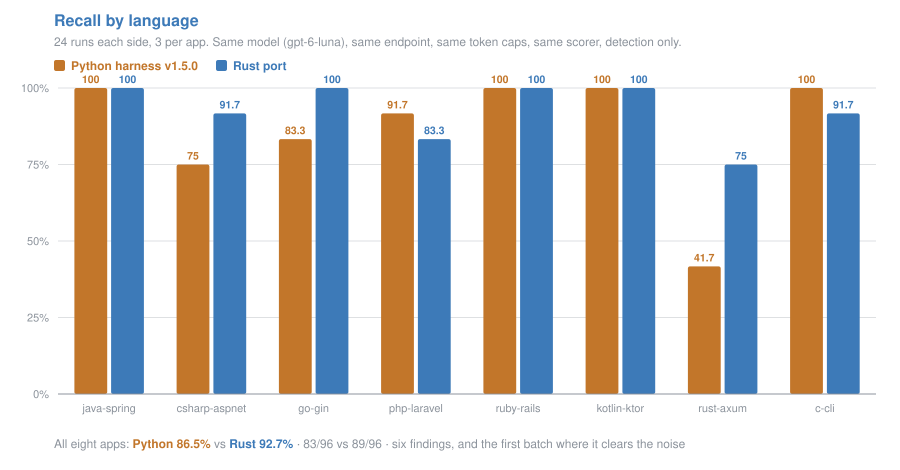
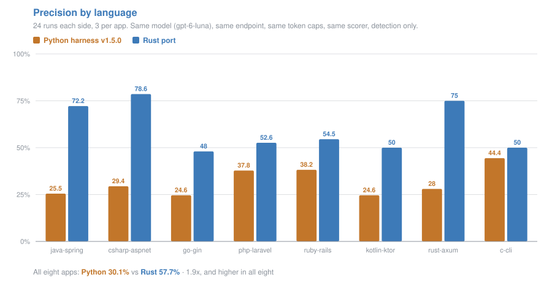
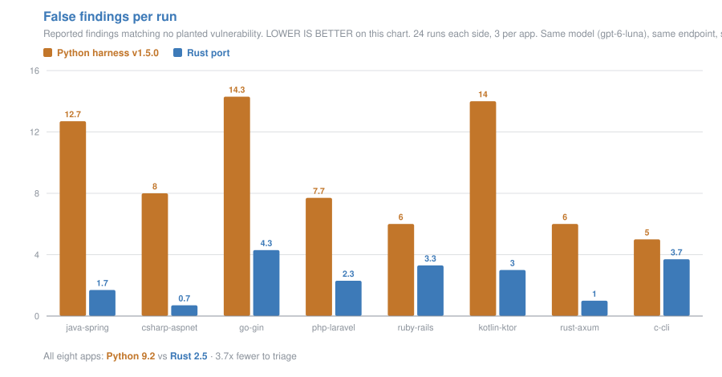
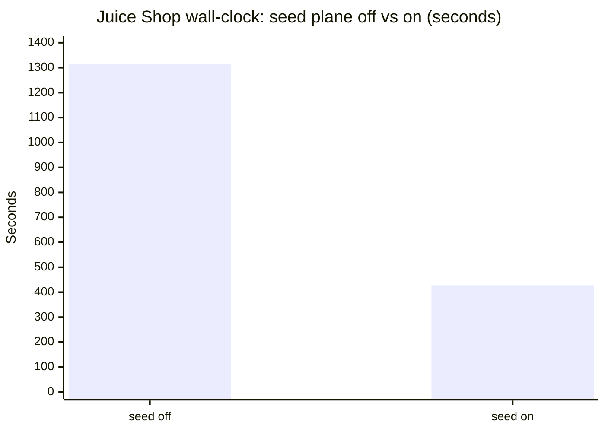
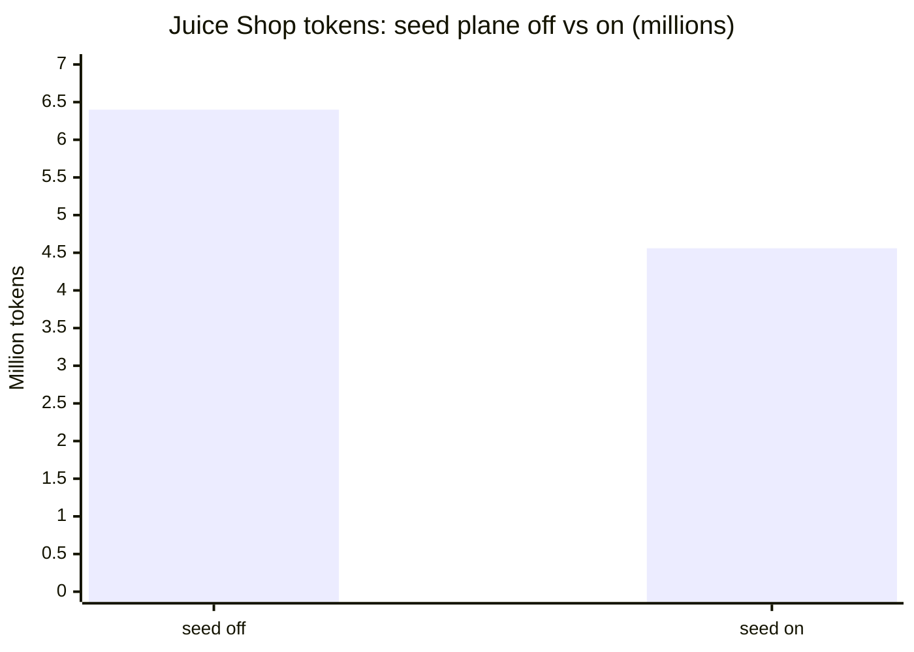
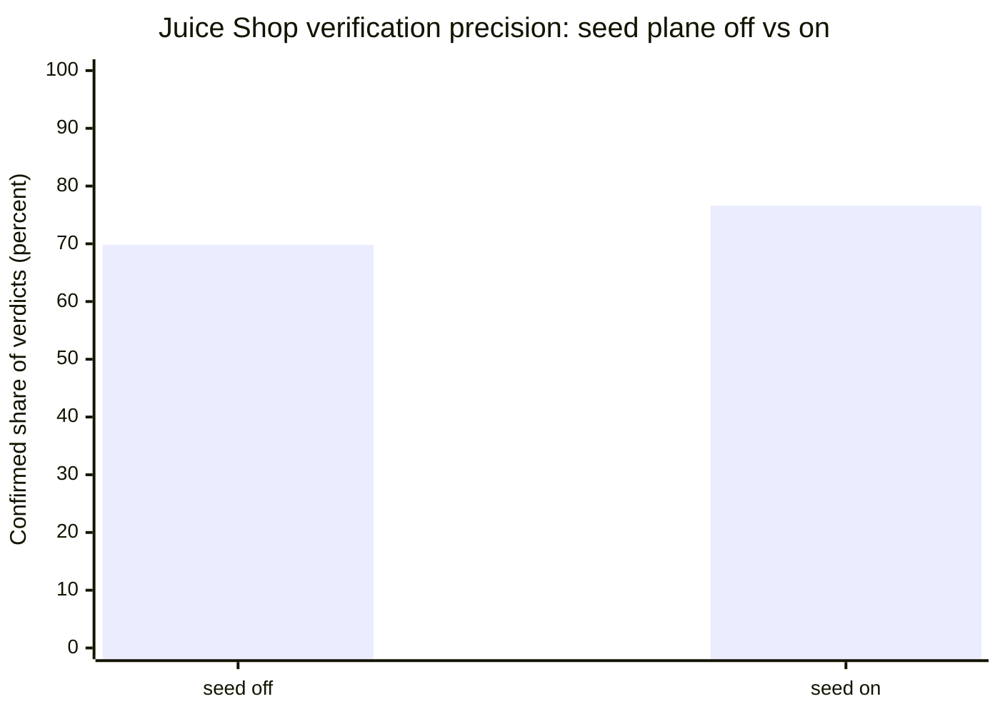
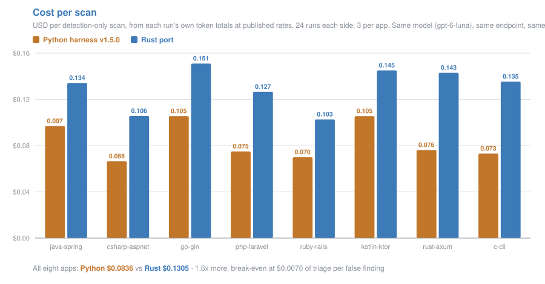

# bc-sast vs. the Python harness it was ported from

`bc-sast` is a Rust port of
[`visa-vulnerability-agentic-harness`](https://github.com/visa/visa-vulnerability-agentic-harness)
("VVAH"). This document is the head-to-head measurement between the two,
re-measured on **2026-10-21/22 against VVAH v1.5.0**, the current upstream
release, with both scanners on the same model, the same wire API, the same
per-step token caps and the same scorer.

**48 runs: three per app per scanner, across eight languages.** Earlier
revisions of this document reported single runs against v1.2.0 on
`gpt-4o`; those numbers are superseded and are not reproduced here,
because several of them were measured under controls that were not
actually equal.

The short version: **the two find about the same bugs, and one of them
says so far more precisely.**

| | VVAH v1.5.0 | `bc-sast` |
|---|---|---|
| Recall | 86.5% (83/96) | **92.7%** (89/96) |
| Precision | 30.1% (97/322) | **57.7%** (90/156) |
| False findings per run | 9.2 | **2.5** |
| Findings reported per run | 13.4 | **6.5** |
| Cost per scan | **$0.0836** | $0.1305 |

The precision gap is the result: **1.9x, in the same direction in eight of
eight languages.** The recall edge is six findings out of 96 and is
smaller than it looks. The Python harness is cheaper per scan, and whether
it is cheaper overall turns on one number no manifest contains -- what it
costs to read and dismiss a finding that is not real. That is stated as a
[break-even](#the-cost-that-actually-matters) rather than a verdict.

Two of eight apps go the other way, and they are in the table like
everything else: VVAH wins `c-cli` (100% against 91.7%) and `php-laravel`
(91.7% against 83.3%).

> [!IMPORTANT]
> **This port had four defects fixed during the study; the upstream
> harness had none.** These tables compare `bc-sast` at HEAD against stock
> `vvaharness` v1.5.0, not two designs given equal scrutiny. One of those
> fixes removed a handicap on this port and one of the benchmark
> corrections removed a handicap on the Python side. See
> [What is not equal](#what-is-not-equal-and-must-be-read-with-the-numbers),
> which is the section to read before quoting any number here.

---

## Contents

- [Feature comparison against v1.5.0](#feature-comparison-against-v150)
- [Methodology](#methodology)
- [Results: the polyglot test bed](#results-the-polyglot-test-bed)
- [Results: OWASP Juice Shop backend](#results-owasp-juice-shop-backend)
- [Results: a multi-file Flask pull request](#results-a-multi-file-flask-pull-request)
- [Cost](#cost)
- [What each one does better](#what-each-one-does-better)
- [Behavioral differences, verified against the code](#behavioral-differences-verified-against-the-code)
- [Deliberately not ported](#deliberately-not-ported)
- [Limitations of this comparison](#limitations-of-this-comparison)
- [Reproducing these numbers](#reproducing-these-numbers)

---

## Feature comparison against v1.5.0

Current as of **2026-10-20**, read from both codebases rather than from
release notes. Every row was checked against the source on both sides; where
a capability is partial, the cell says what is missing rather than taking a
tick or a cross.

No benchmark number appears in this section. Nothing here has been measured
head-to-head against v1.5.0, and that is stated rather than implied.

### Detection

| | `bc-sast` | VVAH v1.5.0 |
|---|---|---|
| Structural analysis | In-process call graph and taint walk over tree-sitter | Embedded ArcadeDB code graph, queried by agent tools |
| Token-free seed plane | Yes | Yes |
| Model-free stages | S0 | S0, S1, S3, S5, and S8 ranking |
| Graph exposed to the model as tools | No | Yes, for S2/S4/S6 |
| Multi-run voting on the deep dive | Configurable, defaults to one run | Removed in v1.5.0 |
| Deterministic detectors that add findings | No, S5 gates only suppress | Yes |
| Injected detection skills | No | 17 |
| Languages in the seed plane | 11 | Tree-sitter grammars, pinned exactly |

### Verification and triage

| | `bc-sast` | VVAH v1.5.0 |
|---|---|---|
| Adversarial verification stage | Yes, S6 | Yes, S6 |
| Semantic dedup | Yes, S7 | Yes, S7 |
| Exploit chaining | Yes, S8 | Yes, S8 |
| Live exploit verification | No, deliberately not ported | Yes, since v1.4.0 |
| Third-party scan ingestion | 5 vendors: Aikido, Checkmarx, Semgrep, Snyk, Sonatype | Semgrep, as a reference plugin |
| Assessments written back to the vendor | Yes | No |
| Plugin SDK for outside enrichers and tools | No | Yes |

### Remediation

| | `bc-sast` | VVAH v1.5.0 |
|---|---|---|
| Agentic fix loop | Yes, S10 | Yes |
| Worktree isolation | Yes | Yes |
| Validation panel | Yes, S11, on by default | Yes, opt-in |
| Rollback when a fix cannot be verified | Yes | Yes |
| Cross-file fixes applied automatically | No, reported only | Configurable |
| Target-repository test execution | Yes, opt-in, no execution in shipped profiles | No |
| API specification step | Yes, 8 standards | No |

### Operations

| | `bc-sast` | VVAH v1.5.0 |
|---|---|---|
| Install | Single static binary, or a container | Python 3.11+, plus native wheels |
| Platform matrix | Any target Rust builds | macOS arm64, Linux x86_64/aarch64 (glibc 2.34+), Windows amd64 |
| A failed graph build aborts the scan | No graph to fail | Yes |
| Cooperative Ctrl-C, partial report, exit 130 | Yes | Cancellation, without the partial-report contract |
| Diff scope enforced end to end | Yes, including imported third-party findings | Diff scope, not extended over imports |
| Per-call cost reporting | Yes, priced per context tier | Yes |
| Token and wall-clock budgets that degrade | Yes | Yes, plus coded exhaustion errors |
| Per-stage model routing | Yes, `models.<role>` | Yes, plus per-stage reasoning effort |
| SARIF built from typed data | Yes, since 1.0.0 | Yes, as of v1.5.0 |
| `findings.json` versioned | No | Yes, `schema_version: "1.0"` |
| Resumable checkpoints | Yes, engine-keyed | Yes, typed schema |

### No longer a difference

Four rows that were advantages and are not any more. A stale comparison is
worse than none:

- **Typed SARIF.** This port built SARIF from typed data from the start.
  v1.5.0 has now moved to the same thing and deleted its Markdown re-parse
  producer. The advantage is gone.
- **The OpenAI Responses API.** Both have a native transport.
- **CWE case-insensitivity in dedup**, and **refusing a corrupt
  `findings.json` before remediating.** v1.5.0 fixed both; this port already
  behaved that way.

### What has not been compared

Every recall, precision and cost figure in this document now reflects
**v1.5.0 on both sides**, re-measured 2026-10-21/22. The v1.2.0 numbers
earlier revisions carried are gone rather than annotated, because several
were measured under controls that turned out not to be equal -- an
unverified wire API on one side and a 4:1 output-token cap on the other.

What is still **not** compared: remediation (both sides run detection
only, `--stop-after s9`), any model other than `gpt-6-luna`, and any
target outside the polyglot bed for the Python side. The Juice Shop and
Flask sections below have no Python column and say so.

Worth stating plainly, because the shape of a comparison document invites
the opposite reading: v1.5.0 made three stages deterministic and added
detectors that contribute findings, and both changes could move its
precision and recall in its own favour. This document does not claim a
current detection result in either direction.

---

## Methodology

### The two scanners

|  | Rust | Python |
|---|---|---|
| Name | `bc-sast` (this repository) | `visa-vulnerability-agentic-harness` **v1.5.0** |
| Invocation | `appsec-scan --repo ... --model gpt-6-luna --openai-api responses --temperature 0 --stop-after s9` | `vvaharness scan --repo ... --config ... --stop-after s9` |
| Configuration | CLI flags | shipped `default.yaml` profile **verbatim**, plus a `config.local.yaml` overlay (the harness's own documented, logged override mechanism) |

The Python side is run as close to stock as it can be run: installed from
the upstream `v1.5.0` tag by `pip install ./vvah-src` on every run, never
from a local copy. The overlay is confined to what the comparison itself
requires:

1. **Model routing.** The shipped profile runs every detection role as
   `via: cli` (a Claude Code subprocess), which would compare two scanners
   on two different models. Every role is repointed at the same OpenAI
   model the Rust runs use, at `temperature: 0`.
2. **Per-step output caps**, set to the same `64000` the Rust port gives
   every step. See [Held equal](#held-equal) -- this one was wrong for a
   while and the correction is recorded there, because it mattered.
4. **S11 validation off**, and its model panel repointed at OpenAI anyway,
   because the startup preflight probes every role in `models.*` whether or
   not its stage is enabled. S11 has no counterpart in the Rust runs.

Everything else keeps the harness default, including its S0 static seed
plane, which `default.yaml` enables.

### Held equal

- **Same model:** `gpt-6-luna`, `temperature 0`, same OpenAI endpoint.
- **Same wire API, verified rather than assumed.** Both sides speak the
  OpenAI **Responses** API. On the Rust side this is pinned with
  `--openai-api responses` and then **checked in all 24 run manifests**:
  every role records `transport_resolved: responses` with `fell_back:
  false` and a run-wide `responses_fallbacks: 0`. An earlier series was
  discarded because it ran under `--openai-api auto`, which records only
  the strategy and not the endpoint, so nothing in the artifacts could say
  which API had answered.
- **Same per-step output cap: 64000.** This was *not* equal in an earlier
  series, and the correction is the reason this section is explicit. The
  Python overlay capped every step at 16000, correct for `gpt-4o`'s
  16384-token completion ceiling and a 4:1 handicap once the benchmark
  moved to `gpt-6-luna` against the Rust port's 64000. It bit: those
  manifests record `llm_truncated_retry_attempted: 4` and
  `llm_truncated_retry_recovered: 4` across 27 runs, against zero
  truncations on the Rust side. The harness's own retry recovered every
  one, so nothing was lost -- but an unequal setting does not belong in a
  like-for-like benchmark whether or not it changed the answer. At matched
  caps there are **no truncations on either side**.
- **Neither side sends a seed.** The Responses API has no `seed`
  parameter, so `--seed` is inert there for both. `temperature 0` is sent
  and accepted by both. This is the ceiling on determinism and it is
  OpenAI's, not either scanner's -- see
  [the variance caveat](#sample-sizes-and-the-variance-caveat).
- **Same scope:** the same `step1` exclude list on both sides. Supplying it
  on the Python side also disables the profile's AI auto-exclude survey, so
  the scope is deterministic and costs no extra model call.
- **Same stopping point:** detection only, `--stop-after s9` on both. No
  remediation on either side.
- **Same scorer, same ground truth:** `polyglot/score.py` in the demo
  repository, against the identical checked-in `ground-truth.json`.
- **Ground truth is hidden from both.** Each app's `ground-truth.json` is
  moved out of the scan target before the scan starts and moved back
  afterwards. Neither scanner ever sees the answers.
- **Both runs happen in GitHub Actions**, on `ubuntu-latest`, one app per
  run, with the scanner built from a **pinned commit** rather than a branch
  name.

### What is not equal, and must be read with the numbers

**The Rust port had four defects fixed during this study. The Python
harness had none.** Fixing upstream's code is not ours to do, but it means
these tables compare *`bc-sast` at HEAD* against *stock `vvaharness`
v1.5.0*, not two designs given the same scrutiny. A reader could
reasonably assume otherwise, so it is stated here rather than inferred.

Corrections went in both directions, which is the part that makes the
comparison usable:

| fix | effect | whom it favoured |
|---|---|---|
| `gpt-6` sampling rule | `--temperature 0` was being dropped before the request was built, so Rust runs sampled non-deterministically while Python's did not | **removed a handicap on Rust** |
| Python per-step output caps | 16000 against Rust's 64000 | **removed a handicap on Python** |
| S3 taint-chunk dedup | ~3% fewer LLM calls, ~5% lower cost, and 11 fewer false positives over 21 runs | Rust |
| S7 dedup survivor | kept an arbitrarily-anchored member of a merged cluster, so a found bug could read as a miss | Rust |

One fixture was corrected too, and it changed a result more than any
scanner fix did. `c-cli` marked all four of its flaws
`reachable_from_unauth: true` while installing the binary `0755`
non-setuid with no config install rule -- so every input was the invoking
user's own, nothing crossed a privilege boundary, and **both** scanners
correctly put all four out of scope under a standard triage exclusion.
Both found the flaws and both refuted them, one verifier writing *"the
repository shows no lower-privileged way to modify that file"*. The
fixture was scoring correct reasoning as a miss. It now installs setuid to
a service account with a group-writable notice config, which is what its
ground truth always asserted. `c-cli` numbers from before that change are
not comparable with these, and the deliberate non-fix is worth naming:
the exclusion rule was **not** weakened, because it is what produces the
precision this bed exists to measure.

### Ground truth

Each polyglot app ships a `ground-truth.json` holding:

- `expected`: one entry per seeded vulnerability, carrying its id, CWE, the
  **exact** sink file and line, the **exact** source file and line, a title,
  and `reachable_from_unauth`.
- `negative_controls`: the safe counterpart of a seeded shape (a bound
  placeholder, a bounded copy), with the line it lives on and why it is safe.
- `routes`: method, path, handler, and whether the route carries an auth
  guard.

Line numbers were generated mechanically from markers in the source, so
they are exact rather than approximate.

### The scorer, and what "precision" means here

A finding **matches** an expected item when *both* hold:

1. **The CWE agrees**: the finding's CWE equals the expected CWE, or sits
   in the same family. The scorer carries eleven explicit families (SQL/NoSQL
   injection; command injection; path traversal; code injection and dynamic
   include; deserialization; XXE; SSRF; memory bounds; use-after-free and
   double-free; format string; authorization), so a scanner that says
   CWE-787 where the truth says CWE-125 has still found the same bug.
2. **The location agrees**: one of the finding's locations names the
   expected item's sink *or* source file, with the expected line inside
   `line_start - 5 .. line_end + 5`. A finding's locations are its top-level
   `file` plus `line_start`/`line_end`, and also whatever its `source_ref` /
   `sink_ref` fields say.

Then:

```
recall    = seeded flows found / seeded flows            (out of 4 per app)
precision = matched findings / ALL findings reported
controls  = negative controls wrongly reported           (out of 1 per app)
```

> [!IMPORTANT]
> **"Precision" here is stricter than the word usually implies.** The
> denominator is *every* finding the scanner reported. A finding that is a
> perfectly real vulnerability, correctly located, but simply not one of the
> four the app's author seeded and wrote down, still counts against
> precision. It is better read as **"share of output that lands on a
> known-planted flaw"** than as "share of output that is true". Both
> scanners are penalized the same way by the same rule, which is what makes
> the comparison fair, but neither number is a false-positive rate.

Negative controls are scored the other way round and **without regard to
CWE**: any finding landing within ±5 lines of a control counts against it.
Some apps deliberately keep the safe query a few lines from the seeded one
(discriminating between them in the same file is the point), so a finding is
credited to whichever line it is actually nearer. Only a report *strictly*
closer to the safe line is a false positive; ties go to the expected item.

The scorer always exits 0. It measures; it does not gate.

### Sample sizes, and the variance caveat

**Three runs per app per scanner -- 24 runs each side, 48 in total.** Every
per-app cell below is the pooled result of three samples, not one.

> [!WARNING]
> **This is still a stochastic system, and the variance is large.**
> `temperature 0` is sent and accepted by both scanners, but neither sends
> a seed, because the OpenAI Responses API has no `seed` parameter. So
> `temperature 0` is the only determinism control available to either
> side, and it is not sufficient.
>
> The size of that is not hypothetical, and it is worth one concrete case.
> On `rust-axum`, one scanner at `temperature 0` over identical source
> scored **75%, 75% and 50%** across three runs -- a 25-point swing from
> sampling alone. On `c-cli`, two of the four planted flaws were found in
> one run out of three each, until a dedup defect behind that was fixed.
>
> Read per-app rows as indicative and the pooled totals as the signal. A
> one- or two-finding difference in a single row means nothing. The
> precision gap -- roughly two-fold, in the same direction in **eight of
> eight** languages -- is what survives the noise. The recall difference is
> three findings out of 96 and should be read as near parity, not as a
> win.

Pooling, rather than averaging the per-run percentages, is deliberate: a
mean of means weights a run that found 1 of 4 the same as one that found
4 of 4. Every aggregate below is `sum(matched) / sum(expected)` over all
runs in scope.

One asymmetry in the sampling itself: the Python side is **uncapped**. It
has no token budget and no wall-clock cap, so its cost figures are a
single sample of a distribution with no ceiling, stopped only by the
workflow's `timeout-minutes`. The Rust runs carry `--max-tokens 1500000`
and `--max-scan-seconds 4800`. Neither limit was reached in any run
reported here, so they did not shape these results, but they bound the
Rust tail and nothing bounds Python's.

---

## Results: the polyglot test bed

Eight small applications, one per language, each with the same skeleton:
**4 seeded cross-file vulnerabilities** (user input read at an entry
point, passed through a helper in a second file, reaching a sink in a
third), **1 parameterized negative control** (the same shape done
safely), and, for the seven with an HTTP surface, one unauthenticated
route plus at least one behind a framework-idiomatic auth guard. `c-cli`
is a command-line tool and has no routes; its privilege boundary is its
setuid install.

Three vulnerability classes are common to all eight (SQL injection,
command injection, path traversal), plus one idiomatic to each language.
So a gap in the table is a gap in a language's coverage, not a difference
in the sample code.

### The table

| app | Python recall | Rust recall | Python precision | Rust precision |
|---|---|---|---|---|
| `c-cli` | **100.0%** (12/12) | 91.7% (11/12) | 44.4% (12/27) | **50.0%** (11/22) |
| `csharp-aspnet` | 75.0% (9/12) | **91.7%** (11/12) | 29.4% (10/34) | **78.6%** (11/14) |
| `go-gin` | 83.3% (10/12) | **100.0%** (12/12) | 24.6% (14/57) | **48.0%** (12/25) |
| `java-spring` | 100.0% (12/12) | 100.0% (12/12) | 25.5% (13/51) | **72.2%** (13/18) |
| `kotlin-ktor` | 100.0% (12/12) | 100.0% (12/12) | 24.6% (14/57) | **50.0%** (12/24) |
| `php-laravel` | **91.7%** (11/12) | 83.3% (10/12) | 37.8% (14/37) | **52.6%** (10/19) |
| `ruby-rails` | 100.0% (12/12) | 100.0% (12/12) | 38.2% (13/34) | **54.5%** (12/22) |
| `rust-axum` | 41.7% (5/12) | **75.0%** (9/12) | 28.0% (7/25) | **75.0%** (9/12) |
| **all eight** | **86.5%** (83/96) | **92.7%** (89/96) | **30.1%** (97/322) | **57.7%** (90/156) |





### Reading it

**Precision is the result.** 57.7% against 30.1% is a 1.9-fold gap, and
it runs in the same direction in **eight of eight** languages. That
consistency is what makes it a finding; at three runs per cell no single
app's number is trustworthy on its own.

**Recall is a real but smaller edge.** 89/96 against 83/96 -- six
findings. This is the first batch where it clears the measured noise
floor, and it only does so because a dedup defect was fixed first (see
[What is not equal](#what-is-not-equal-and-must-be-read-with-the-numbers)).
Read earlier claims of a recall advantage with suspicion; earlier batches
put it at three findings, which is inside the noise.

**Two apps go to the Python harness.** `c-cli` 100% against 91.7%, and
`php-laravel` 91.7% against 83.3%. The `c-cli` row is the honest one to
dwell on: it is the memory-safety app, the Python harness finds all four
planted flaws in all three runs, and this port does not.

**The negative controls separate nothing.** Neither scanner wrongly
reported a single safe counterpart, in any run. That is a credit to both
and it is reported here because a reader is entitled to the cells where
the comparison found no difference.

### False findings

Precision expressed as a count is the number that reaches whoever has to
read the report, so it is worth stating separately from the ratio.

| app | Python false findings/run | Rust false findings/run |
|---|---|---|
| `c-cli` | 5.0 | **3.7** |
| `csharp-aspnet` | 8.0 | **0.7** |
| `go-gin` | 14.3 | **4.3** |
| `java-spring` | 12.7 | **1.7** |
| `kotlin-ktor` | 14.0 | **3.0** |
| `php-laravel` | 7.7 | **2.3** |
| `ruby-rails` | 6.0 | **3.3** |
| `rust-axum` | 6.0 | **1.0** |
| **mean** | **9.2** | **2.5** |



Every reported finding that matches no planted vulnerability costs
somebody the time to open the file, follow the flow and decide it is not
real. That is the work the precision gap is actually about.

### Negative controls

Each app ships one safe counterpart of a seeded shape -- a bound
placeholder, a bounded copy -- and reporting it is a false positive of the
most embarrassing kind, because the control exists precisely to look like
the bug.

Across all 24 runs each side: the Python harness wrongly reported **0 of 20**; the Rust port **0 of 18**.

### Where the difference comes from

The Python harness reports **13.4 findings per run** to convey **3.46**
real ones. This port reports **6.5** to convey **3.71**. It is not
finding less and reporting less; it is finding slightly more and
reporting half as much.

The stages that do it have no Python counterpart in these runs: the seed
plane's evidence packing, an adversarial verifier that can refute a
candidate outright, and a pre-verify dedup pass. That is also where the
extra cost goes, so the precision and the price are the same mechanism
seen from two sides.

## Results: OWASP Juice Shop backend

A real application rather than a test bed: 199 backend files, 150 of them in
scope after exclusions. **These are Rust-only runs** (back-to-back, on the
same commit family), measuring what the S0 seed plane is worth. There is no
Python column here.

| | seed plane **off** | seed plane **on**, correct scope |
|---|---|---|
| wall-clock | 1313 s | **428 s** |
| tokens | 6.40M | **4.56M** |
| raw candidates | 277 | 141 |
| confirmed | 171 | 98 |
| refuted | 74 | 30 |
| verification precision | 69.8% | **76.6%** |
| verifier errors | n/a | **0** |
| rate-limit retries | n/a | **0** |
| budget outcome | **cap tripped before S7** | completed |
| canonical challenge files hit | 14/15 | 14/15 |

Verification precision here is `confirmed / (confirmed + refuted)`, the
share of what the detection stage proposed that survived the verifier. It is
a different measurement from the polyglot bed's precision, which is scored
against hand-written ground truth. In the seed-on run every raw candidate
is accounted for: 98 confirmed, 30 refuted, 8 collapsed as duplicates
before verification, 4 excluded by the deterministic S5 gates (three
template auto-escape, one test path) and 1 left unconfirmed by the
verifier. In the seed-off run the remainder never reached a verdict,
which is what the budget cap tripping before S7 means.







**3.1x faster, 29% fewer tokens, 6.8 points more precise, and it finished
instead of hitting the cap**, while hitting the same 14 of 15 canonical
challenge files. The seed plane is not a detection aid so much as a
*targeting* aid: it spends static analysis to avoid spending model calls.

See [`diagrams/seed-plane.md`](diagrams/seed-plane.md) for what it actually
computes.

### The fix series that got it there

Juice Shop was scanned repeatedly while defects found in the previous run
were fixed. The measurable deltas, each attributable to one change:

| change | before | after |
|---|---|---|
| `Retry-After` handling on burst 429s | 24 verifications lost to rate limiting | **0** |
| JS/TS event-loop gate | 16 race-condition false positives | **8** |
| template auto-escape gate | n/a | XSS candidates in auto-escaped templates dropped deterministically |
| same-range CWE merge in S7 | 20-23 duplicate findings per run | **collapsed** |

These are the deterministic gates described in
[`diagrams/finding-lifecycle.md`](diagrams/finding-lifecycle.md). None of
them asks the model anything; they are all cheap, repeatable filters applied
to what the model already said.

---

## Results: a multi-file Flask pull request

Seven runs against the same multi-file Flask pull request, exercising the
GitHub Action path end to end.

- The **last two runs kept 5 of 5 finding identities** across runs. The
  same finding got the same id, so a PR comment could be updated rather than
  duplicated.
- **Remediation succeeded 5/5 and 6/6.**
- **PR comments reconciled**: on re-run, existing comments were updated in
  place; no duplicates were posted.

Finding identity stability is the thing that makes the Action usable on a
busy PR. Without it, every push re-posts every comment. See
[`diagrams/finding-lifecycle.md`](diagrams/finding-lifecycle.md) for how the
id is built and matched.

---

## Cost

Both sides are priced by the **same external calculation**, not by one
side's own figure against a derivation of the other's. That matters here:
the Python harness reports `cost_usd: null` with
`pricing_status: {"status": "unavailable", "reason": "no pricing table
configured"}`, so it supplies token counts and no money. Taking the Rust
port's self-reported cost and hand-deriving Python's would compare two
different methods.

The formula is `fresh_input x rate + output x rate + cache_read x rate +
cache_write x rate`, at `gpt-6-luna`'s published per-token rates, where
`fresh_input = input - cache_write` because **both manifests report input
GROSS** -- the cache-write tokens are already inside it. It is validated
against the Rust port's own `cost_usd` on every run and reproduces it to
**zero error**, which is the check that makes the Python column
trustworthy rather than plausible.

> [!NOTE]
> That validation exists because the obvious version of this arithmetic
> was wrong. Charging `input` and `cache_write` both at full rate
> double-counts the overlap and inflates every figure by
> `cache_write x input_rate` -- about 26% on these runs. It produced a
> self-consistent table that disagreed with the scanner's own number, and
> the discrepancy was briefly explained away as per-call price tiering
> before the actual cause was found. The harvest script now asserts the
> reproduction and refuses to print numbers it cannot reconcile.

### Per scan

| app | Python $/scan | Rust $/scan | ratio |
|---|---|---|---|
| `c-cli` | $0.0731 | $0.1354 | 1.85x |
| `csharp-aspnet` | $0.0664 | $0.1056 | 1.59x |
| `go-gin` | $0.1055 | $0.1510 | 1.43x |
| `java-spring` | $0.0969 | $0.1342 | 1.38x |
| `kotlin-ktor` | $0.1055 | $0.1451 | 1.37x |
| `php-laravel` | $0.0750 | $0.1266 | 1.69x |
| `ruby-rails` | $0.0700 | $0.1027 | 1.47x |
| `rust-axum` | $0.0762 | $0.1430 | 1.88x |
| **mean** | **$0.0836** | **$0.1305** | **1.56x** |



### The cost that actually matters

Cost per scan is the wrong denominator on its own, because the two
scanners do not deliver the same thing. A finding that is not real still
has to be read, traced and dismissed by somebody.

| | Python | Rust |
|---|---|---|
| findings reported per run | 13.4 | **6.5** |
| distinct planted bugs found per run | 3.46 | **3.71** |
| false findings per run | 9.2 | **2.5** |
| cost per bug found | $0.0242 | $0.0352 |
| cost per REPORTED finding | $0.0062 | $0.0201 |

So the Rust port costs more per scan and returns a smaller pile with a
larger true share. Whether that is cheaper depends on one number nobody
can take from a manifest -- what it costs to triage a false finding -- so
the honest form of the claim is a **break-even**:

The Rust port spends **$0.0469** more per scan and returns **6.7** fewer false findings. Break-even is **$0.0070** of triage time per false finding.

Above that figure, the Rust port is cheaper in total cost of ownership.
Below it, the Python harness is. The figure is small enough that any
plausible cost of a security engineer's attention clears it, but it is
stated as a threshold rather than a conclusion because the inputs to it
are not ours to assert.

### What the extra spend buys

The Rust port makes more calls per scan, and they are not the same calls.
Python's pipeline stops at detection with no source/sink references
emitted; the Rust port additionally runs the seed plane's evidence
packing, an adversarial verifier that can refute a candidate, and the
attack-chain stage. The verifier is where most of the precision gap comes
from, and it is a cost line Python does not have because it does not do
the work.

## What each one does better

### Where the Python harness was credited and the Rust port was not

Stated first, because it is the part a comparison written by the porting
team is most likely to bury.

1. **`csharp-aspnet` recall: Python 4/4, Rust 3/4.** The port anchored the
   SQL injection at the method header, outside the scorer's window. Python
   put it on the sink line. Anchoring precision is a real property and
   Python won that row on the measurement as run.
2. **`go-gin` recall: Python 4/4, Rust 3/4.** Python filed the SSRF as
   CWE-918. The port filed it as CWE-20/285, a defensible reading (the
   handler does fail to validate a URL) that is nonetheless the *less
   useful* classification, and it cost the match.
3. **`c-cli` recall: Python 4/4 on the class, Rust 3/4.** The port anchored
   the use-after-free at the `free()` rather than the later read. Fixed
   and re-measured: see "After the fixes" below.
5. **`rust-axum` negative control: Python 0/1, Rust 1/1.** The port reported
   the safe bound-parameter query as a finding. Python did not. This is a
   plain false positive on the port's side, on the one app where the safe
   path is *statically impossible* to misuse (it takes `&'static str`).
6. **`csharp-aspnet` precision denominator: Python found 5 matching
   findings, the port 3.** Python's extra credited finding is a second
   report hitting the same seeded item. It is noisier, but it did land.
7. **Python is cheaper on `go-gin`** (273,225 vs 220,831 tokens, though
   note this is the direction *against* Python; see the caveat above).

Taken together: the port's anchoring and CWE-assignment discipline is
**not** strictly better than the harness's. On three of eight apps it was
worse in a way that a stricter scorer would punish and a human triager would
forgive.

### Where the Rust port is better

1. **Precision: 57.7% vs 30.1%**, in the same direction in eight of eight
   languages, on slightly better recall. **6.7 fewer false findings per
   run** -- 160 fewer across the 24 runs -- which is the number that reaches
   whoever reads the report.
2. **Reproducibility of everything that is not the model.** Verification
   results are emitted in input order rather than completion order and
   then sorted by content; dedup keys on CWE and flow identity rather than
   on the model's chosen class label; the static seed plane is fully
   deterministic and measured as such (identical sink and entry-point
   counts across all three runs of every app).

   **This does not make a run reproducible, and an earlier revision of
   this document wrongly implied it did.** It claimed "two runs of the
   same commit produce the same report". They do not. `--seed` is plumbed
   through, but the OpenAI **Responses API has no `seed` parameter**, so
   on the transport both scanners now use it is inert; `temperature 0` is
   the only control either side has, and greedy decoding is not
   deterministic on production serving infrastructure. Measured on this
   bed: the same scanner, same commit, same app, same model scored 40%,
   33% and 80% precision across three runs. The divergence is traceable  -- 
   it begins at the first model call that exercises judgement and
   cascades, because a threat model with 18 entries instead of 27 packs
   different chunks, which changes how many deep-dive calls run and what
   each one sees. See
   [the variance caveat](#sample-sizes-and-the-variance-caveat).
3. **Honesty of reporting.** Structured `findings.json` carrying source and
   sink references, a real SARIF built from the finding objects with stable
   fingerprints, and a `## Dropped Findings` section recording every
   rejected candidate with a tagged reason, plus a `Not verified` count
   under `## Verification` and a **BUDGET REACHED** line under
   `## Scan Health`. A run that ran out of budget says so, rather than
   silently reporting less.
4. **Robustness.** Quota exhaustion is distinguished from a burst rate-limit
   and fails in seconds rather than retrying for the length of the timeout;
   `Retry-After` is honored; an oversized `max_tokens` is self-corrected
   rather than turning into a zero-finding scan.
5. **Operability.** Token budget, wall-clock cap, output paths, checkpoint
   resume, diff scope, batch `--repo-file`.
6. **Remediation safety.** Fixes run behind a deterministic policy gate with
   diff capture and revert, rather than editing target source by default.

---

## Behavioral differences, verified against the code

Every row below was checked against both codebases before publication.
Where the convenient version of a claim turned out to be too strong, the
weaker true version is what appears here. Four of these seven needed
correcting, and the corrections are called out in place.

| | Python VVAH | Rust `bc-sast` |
|---|---|---|
| **HTTP 429** | classified by status code alone and retried on a fixed ladder; no `Retry-After` handling anywhere. Only the Claude-CLI backend detects a hard cap, and only for its own call | body classified: quota exhaustion is a distinct non-retryable error that trips a **scan-wide** gate; `Retry-After` honored as a floor |
| **Determinism knobs** | no `--seed`, no token budget, no wall-clock cap; model and temperature config-file only | all five on the CLI |
| **Outputs** | Markdown + SARIF only, into a hardcoded directory. **SARIF is regex-parsed back out of the Markdown.** No fingerprints | Markdown + SARIF + CSV by default, findings JSON opt-in. SARIF built from typed data, with v1 and v2 fingerprints |
| **`gpt-4o` out of the box** | ships `max_tokens: 64000`; the model rejects it and the error is unrecoverable, so a stock run finds **nothing** | same defaults, but the limit is parsed out of the provider's own error text and retried |
| **Output ordering** | S6 emits in completion order and never reorders; S7 keeps the lowest index, so **network timing chose the survivor** | S6 emits in input order; S7 applies a nine-key content sort |
| **Dedup key** | same file **and** same class required; CWE can only veto | flow identity, or sink identity under an equal CWE, or line proximity; plus a same-range different-CWE merge |
| **Step-0 rules fallback** | **inert** (its rule files ship in neither the repo nor the wheel) | corpus embedded in the binary: 21 source rules, 87 sink rules |

### 1. What happens on an HTTP 429

**Python** classifies a 429 by status code alone, without looking at the
body: `_RETRYABLE_STATUS = {429, 500, 502, 503, 504, 529}`. It retries on a
fixed ladder (60 s twice on the single-shot path, 10/20/30/40 s on the
agentic path), and there is **no `Retry-After` handling anywhere** in the
package.

One correction to the simple story: Python's Claude-CLI subprocess backend
*does* recognize a hard cap, matching `hit your (usage )?limit.*resets` and
returning immediately. But that is the Claude subscription-window message,
not an API billing 429 (`insufficient_quota`, "credit balance is too low"),
and it aborts only that one call. There is no scan-wide gate, so every
other in-flight and queued session rediscovers the wall independently.

**The Rust port** reads the body. `QuotaExhausted` (matching
`insufficient_quota`, `credit_balance_exhausted`, `spend_limit_exceeded`,
`usage_limit_exceeded`, "exceeded your current quota", "billing hard limit")
is a distinct, deliberately non-retryable error, and hitting it **trips a
scan-wide budget gate** from inside S4 or S6 so queued work skips its own
calls instead of rediscovering the failure. `Retry-After` is honored as a
*floor* rather than a schedule.

The port carries the reason in a code comment: without the shared gate, each
of S6's ~250 verification sessions had to rediscover quota exhaustion
independently, and retry it six times apiece first.

### 2. Determinism and budget knobs

| | Python | Rust |
|---|---|---|
| `--seed` | none (the harness never sends a seed) | yes, on the OpenAI dialect |
| token budget | none | `--max-tokens` |
| wall-clock cap | none | `--max-scan-seconds` |
| model, temperature | **config file only** | `--model`, `--temperature`, `--top_p`, `--step-timeout` |
| output paths | hardcoded `<repo>/security-scan/`, no `--out-*` flags | same `<repo>/security-scan/` default, movable with `--out-dir` or per format with `--out-md`, `--out-sarif`, `--out-csv`, `--out-findings-json`; plus opt-in `--out-remediation-json` |

Python's complete `scan` flag list is `--repo`/`--repo-file`, `--config`,
`--repo-name`, `--application-id`, `--workspace`, `--keep-clones`,
`--group-by-app`, `--resume`, `--stop-after`, `--remediate`, `--top`,
`--force`, `--skip-preflight`, `--step1-config`, and
`--auto-step1`/`--no-auto-step1`. That is the whole surface.

### 3. What each one writes

**Python** emits Markdown and SARIF only, and **the SARIF is regex-parsed
out of the rendered Markdown**: step 9 hands `md_to_sarif` the on-disk `.md`
path, which reopens it and rebuilds `Finding` objects from the text with
header/location/CWE/CVSS regexes. The typed objects that produced the report
are discarded and reconstructed from their own rendering. No findings JSON,
no CSV.

Two corrections worth making, because the uncharitable version is wrong:

- **Python's SARIF is not location-poor.** It emits `relatedLocations` from
  dedup-collapsed call sites, a CWE taxonomy in `taxa`, `rank`,
  `security-severity`, and CVSS properties. What it lacks is
  `partialFingerprints`: it has none, which is why nothing downstream can
  match an alert across runs.
- **`source_ref` and `sink_ref` exist in Python.** They are fields on its
  internal `Finding` model. They are rendered only into the S8 chain
  prompt, never into the Markdown, and therefore never into the SARIF
  parsed from it. The correct phrasing is *carried internally but never
  emitted*, not *absent*.

**The Rust port** writes Markdown, SARIF and CSV by default and findings
JSON on request. Its SARIF is built directly from the typed `FinalReport`
and carries `partialFingerprints` under both `bc/findingId/v1` and
`bc/findingId/v2`. Note the symmetry with the correction above: only the
findings JSON carries `source_ref`/`sink_ref`, and the Rust Markdown and
CSV do not either.

### 4. Talking to `gpt-4o` at all

**Python** ships `max_tokens: 64000` per step in its built-in defaults and
in every shipped profile, an Anthropic-shaped number. `gpt-4o` accepts at
most 16384 completion tokens, and the harness forwards the value straight
through. Its `BadRequestError` handler covers exactly three recoveries: drop
`temperature`, swap `max_completion_tokens` for `max_tokens`, and swap back.
A `"max_tokens is too large: 64000"` body matches none of them, so it
raises, and **a stock run against `gpt-4o` produces zero findings**. Getting
the baseline in this document to run at all required a hand-built config
overlay.

**The Rust port** kept the same 64000 defaults, and clamps at the client.
On a 400 it parses the limit out of the provider's own error text (the
integer after `"supports at most "`) and retries with it, rather than
hardcoding a per-model table. The `64000` to `16384` case is a regression
test.

### 5. Output ordering

**Python's S6** drains a thread pool with `as_completed` and appends each
result as it lands, with no reassembly afterwards. S7 then keeps the
**lowest-index** member of each duplicate cluster, so network timing
decided which duplicate survived, and with it the file, line range, snippet,
CVSS vector and SARIF rule id that got reported.

One correction: **Python's S4 does reassemble in chunk order**. The code
even says "reassemble in risk-rank order so downstream ordering is stable".
The nondeterminism is specific to S6, and the claim should not be made about
Python generally.

**The Rust port** writes S6 results into indexed slots and drains them in
input order, then applies a nine-key content sort in S7.

### 6. What dedup keys on

**Python** requires the same `file` **and** the same `vuln_class`. CWE can
only *veto* a merge, never justify one. `source_ref`/`sink_ref` are
snapshotted into the duplicate record but never consulted as a key.

One correction: **`vuln_class` is not free text.** It is a closed
twelve-value enum, and anything off-list is coerced to `other` before
validation. It is still a per-chunk model choice that moves for the same
bug (which is the substance of the point), but calling it free-text is
factually wrong.

**The Rust port** has three tiers: flow identity (normalized `source_ref`
*and* `sink_ref` both equal; the anchor file need not match at all), sink
identity under an explicit equal CWE, and same-file line proximity. An
equal explicit CWE is **sufficient on its own**, where Python required class
equality. A second pass merges findings on an *exactly* equal line range
filed under *different* CWEs, which has no Python equivalent and is worth
20-23 collapsed duplicates per Juice Shop run.

### 7. The step-0 rules fallback is inert in the shipped package

**Python's** default profile runs step 0 in `llm` mode, which falls back to
`rules` on three conditions: no observed calls, zero specs detected, or an
exception. Rules mode then resolves its rule files to
`rules/sources.generated.yaml` and `rules/sinks.generated.yaml`.

**Neither file ships**, not in the repository, not in the wheel. They are
built from external Semgrep and CodeQL corpora by a separate tool the
operator must run. And the config override that would point elsewhere
defaults to an empty string, which is falsy, so it falls through to the
missing paths. The result is a guaranteed empty seed, and the code prints
exactly that.

This is known rather than accidental: the module docstring says so, and
`pyproject.toml` lists both files in its package-data allowlist: packaging
prepared for files that do not exist. The practical consequence is that if
the LLM pass fails mid-run, step 0 returns **nothing** rather than a
rules-based seed.

**The Rust port** embeds the corpus in the binary (21 source rules and 87
sink rules), so `step0.enabled: true` produces real rule content out of the
box.

### 8. What Ctrl-C does

**Python** has real cooperative cancellation inside S4 and S6: an abort
flag plus a hard kill of every live verifier subprocess tree, because
`KeyboardInterrupt` only fires on the main thread while worker threads
keep dequeuing tasks. The interrupt then propagates: the run ends and no
report is written.

**The Rust port** stops the way a budget stops (`bc_pipeline_core::
CancelToken`, `crates/bc-cli/src/cancel.rs`). The first Ctrl-C trips a
run-wide token every stage gate consults: S4 and S6 start no new chunk or
session, the calls in flight finish, every stage not yet started is
recorded as skipped, S8 builds the report without a model call, and the
partial report, SARIF, CSV and run manifest are still written, marked
`CANCELED` in Scan Health and `"canceled": true` in the manifest.
Nothing is published, posted or remediated from a canceled run. Mid-S10,
the running agent's next model call is refused (its own error path rolls
the partial patch back) and the `verify_command` is killed as a whole
process group. A second Ctrl-C exits at once. Both exit with code 130.
The port differs from Python in writing the partial report at all, and in
not killing an in-flight model call on the first press: there is no
subprocess to kill, only an HTTP request that is left to finish or time
out.

---

## Deliberately not ported

Four Python features were left out on purpose. Each is a decision, not an
omission, and each is recorded as such in the code.

**The Claude Code CLI subprocess backend.** Worth stating clearly: this is
Python's *default* backend, not one option among several: a bare model
string resolves to `via: "cli"`, and every detection role in the shipped
profile uses it. The Rust port has only HTTP dialects (`--dialect
openai|anthropic`), so every call goes through the same gateway-mediated
client. This is also why the baseline runs in this document needed a config
overlay at all: without repointing the roles, the two scanners would have
been compared on two different models. The one piece kept is a
`GuardrailBlocked` error variant, as the gateway-mediated equivalent.

**`max_budget_usd`.** Python enforces this on its Claude-CLI and agent-SDK
backends. On its API backends it is accepted and ignored: the source
comment says `# accepted for parity; unused`. Neither enforcing backend is
ported, so there is nothing here for the key to reach and the Rust port no
longer ships it as a default at all: it is gone from
`bc_config::step_defaults()`, and a config that still sets it loads and
prints a warning naming the caps that are real. The accurate phrasing
is **removed**, not "carried but dead". `--max-tokens` and
`--max-scan-seconds` are the functional replacement, and unlike a USD figure
they are enforceable without a price table.

**`--group-by-app`.** Python's version stages every repository sharing an
application id into one directory and scans the combined tree as a single
repo, so cross-repo call-graph edges become visible. That is a change to
*scan scope*, not a reporting convenience. Approximating it by grouping
separate per-repo reports afterwards would silently misrepresent what the
flag does, so it is left unimplemented rather than faked.

**`scan_progress.style: llm_debug`.** Python's progress tracker
(`util/scan_progress.py`) has a style that prints every model call's full
system and user prompt to stderr. The other four styles are ported
(`--progress-style`, `crates/bc-cli/src/progress_lines.rs`); this one is
not, because prompts carry the target's source code, and a debug switch
that copies source into a CI log is how source ends up in a CI log.

---

## Limitations of this comparison

Read these before quoting any number above.

1. **This port was fixed during the study; the upstream harness was not.**
   Four defects in `bc-sast` were found and fixed between the first and
   last batch, so these numbers are HEAD against stock v1.5.0 rather than
   two designs given equal scrutiny. Corrections ran both ways -- one
   removed a handicap on this port, one benchmark correction removed a 4:1
   output-token handicap on the Python side -- but upstream's own defects
   were left alone, because fixing them is not ours to do. Read
   [What is not equal](#what-is-not-equal-and-must-be-read-with-the-numbers)
   before quoting anything.

2. **Three runs per cell, against a noise floor larger than most of the
   differences.** Within a single batch, the same scanner on the same code
   swung **up to 47 points of precision** between runs, median spread 11-15
   points. So no per-app row is trustworthy on its own, and only two claims
   here clear that floor: the precision gap (because it repeats in eight of
   eight languages) and `c-cli`'s 25-point recall gain (because the dedup
   fix behind it has unit tests on the exact shapes). The aggregate
   precision difference between the last two batches, **-4.9 points, is
   inside the noise and is not attributed to the change that separates
   them** -- in either direction. No confidence intervals are offered
   because three samples cannot support them.

3. **Neither scanner can be made reproducible on this transport.** The
   OpenAI Responses API has no `seed` parameter, so `temperature 0` is the
   only determinism control available to either side, and it is not
   sufficient. The divergence is observable and starts at the first model
   call that exercises judgement: the static seed plane produces identical
   output across every run, S1's constrained output is stable, and the
   threat model is where runs begin to differ (18, 27 and 24 threats on
   one app) -- after which chunk packing, call counts and findings all
   diverge downstream. This is a property of the platform, affects both
   scanners equally, and is the main reason to read totals rather than
   rows. `step4.runs: 2` or higher enables vote-across-samples and trades
   cost for stability; it was deliberately left off so both sides ran
   single-sample.

4. **"Precision" penalizes real findings.** The denominator is all output,
   and the numerator is only findings matching a hand-written ground-truth
   item. A genuine vulnerability the app's author did not seed and write
   down counts as a miss. Both sides are penalized identically, but the
   absolute numbers are not false-positive rates and must not be quoted as
   such.

5. **The Python findings had to be converted, and lost fields on the way.**
   The harness emits no findings JSON, only Markdown and SARIF. A converter
   reconstructs the scorer's input shape from both (the SARIF for file, CWE
   and `startLine`; the Markdown for `line_end`, because the SARIF writer
   only ever emits `startLine`). Critically, the harness's own internal
   `Finding` model *does* carry `source_ref`/`sink_ref` as `"file:line"`,
   but **neither its Markdown writer nor its SARIF writer emits them**, so
   they are lost before any converter can see them. The scorer treats those
   as extra locations a finding may match on. **The Python side is therefore
   matched on its primary location only, while the Rust side gets up to
   three shots at the ±5-line window.** That is a genuine advantage to the
   Rust port, but it is an advantage in *reporting completeness*, not in
   detection, and some unknown part of the precision gap is attributable to
   it rather than to better analysis.

6. **The scan configurations are not identical, and cannot be.** The Rust
   runs used `--seed`, `--max-tokens 1500000` and `--max-scan-seconds 4800`.
   The Python harness has no equivalent for any of the three. The Rust runs
   remediated; the Python runs stopped at `s9`. Making them identical would
   mean disabling Rust features that have no Python counterpart, which
   measures a different thing.

7. **Eight small apps are not a benchmark.** They are 3-4 seeded flows each,
   written to be parseable, in a known set of shapes. Real code is longer,
   messier, and has vulnerabilities nobody wrote down. Juice Shop is the
   only real-application datapoint here, and it has no Python column.

8. **No Python column for Juice Shop, the Flask PR, or remediation.** The
   most operationally interesting results are Rust-only.

9. **One model only (`gpt-6-luna`).** No claim is made about how either scanner behaves on a
   different model, and the Python harness's shipped defaults target
   Anthropic models it was not run against here.

10. **Written by the people who did the port.** The ground truth, the test
   bed, and the scorer were all written on this side of the comparison. The
   scorer's CWE families and ±5-line slack were chosen before the runs, and
   both scanners are scored by the identical code path, but a reader should
   weight self-reported benchmarks accordingly. Everything needed to
   re-derive these numbers independently is listed below.

---

## Reproducing these numbers

Both workflows live in the demo repository, take one target per run, upload
their full output as an artifact, and print the score table into the run
summary.

**Rust port:**

```
gh workflow run bc-sast-polyglot.yml -f app=java-spring
```

Inputs: `app` (one of the eight), `max_tokens` (default `1500000`), `top`
(default `2`), `scanner_ref`. Builds the scanner image from source at
`scanner_ref`, deletes the source before scanning, scans `polyglot/<app>`,
scores it, and uploads `bc-sast-polyglot-<app>`.

**Python harness:**

```
gh workflow run vvah-python-baseline.yml -f target=java-spring
```

Inputs: `target` (the eight apps plus `flask` and `juice-shop`), `model`
(default `gpt-6-luna`, matching the bc-sast workflow), `max_output_tokens`
(default `64000`, matching what this port gives every step -- lower it to
`16000` for `gpt-4o`, which rejects any completion cap above 16384),
`vvah_ref` (default `v1.5.0`), `remediate`, `top`,
`scan_timeout_minutes`. Installs the harness from source at `vvah_ref`, runs
it with the verbatim `default.yaml` plus the overlay, converts its
Markdown+SARIF output into the scorer's shape, scores it, and uploads
`vvah-python-<target>`.

**Comparing two runs:**

```
gh run download <rust-run-id>   -n bc-sast-polyglot-java-spring
gh run download <python-run-id> -n vvah-python-java-spring
diff <(grep -A6 '^Totals' bc-sast-polyglot-java-spring/score.txt) \
     <(grep -A6 '^Totals' vvah-python-java-spring/score.txt)
```

The `Totals` block is the head-to-head number. The per-item tables above it
show *which* seeded vulnerability each scanner missed, which is usually the
more useful read.

**Scoring by hand:**

```
python3 polyglot/score.py <findings.json> <ground-truth.json>
```

---

## See also

- [`diagrams/README.md`](diagrams/README.md): the diagram index.
- [`diagrams/pipeline.md`](diagrams/pipeline.md): the S0-S11 pipeline.
- [`diagrams/seed-plane.md`](diagrams/seed-plane.md): what the seed plane
  computes, and what the 3.1x Juice Shop speedup comes from.
- [`diagrams/finding-lifecycle.md`](diagrams/finding-lifecycle.md): where
  the precision difference is made.
