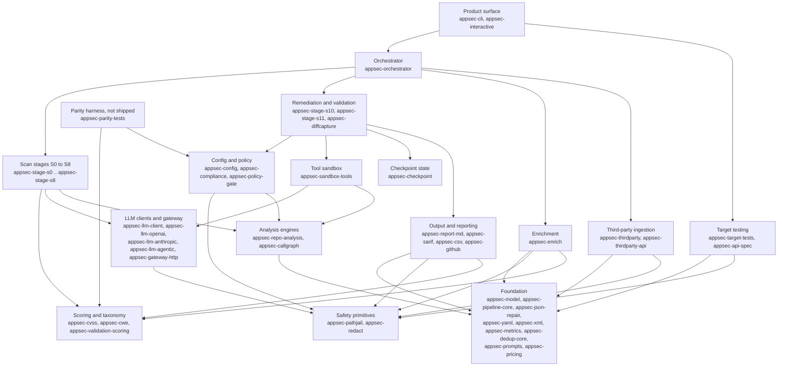

# Crate map

The workspace is `members = ["crates/*"]`: **51 crates**, one binary
(`appsec-cli`, which builds `appsec-scan`). The dependency graph is a strict DAG:
every crate depends only on crates in a lower or equal tier, never a higher
one, and the tiers were derived from the actual `path = "../..."` edges
rather than assigned by hand.

Drawing 51 nodes is unreadable, so this map groups them into 17 boxes and
draws the group-level edges. Edges implied by transitivity are omitted.
`appsec-stage-s4` really does depend on `appsec-model`, but the arrow is not drawn
because *Scan stages to Analysis engines to Foundation* already says so.

## Group-level dependency graph

## What each group is

| Group | Crates | What it is |
|---|---|---|
| **Foundation** | `appsec-model`, `appsec-pipeline-core`, `appsec-json-repair`, `appsec-yaml`, `appsec-xml`, `appsec-metrics`, `appsec-dedup-core`, `appsec-prompts`, `appsec-pricing` | Pure logic, no workspace dependencies. `appsec-model` is the cross-stage DTO spine with lenient LLM-JSON coercion; `appsec-pipeline-core` encodes the "degrade rather than crash" policy as a type; `appsec-prompts` holds shared prompt blocks as `&'static str` so prompt-cache prefixes stay byte-identical; `appsec-pricing` prices one call's token counts against a vendored models.dev table and has no consumer in the pipeline yet; `appsec-xml` is the safe XML 1.0 reader and writer (no DTDs, bounded, namespace-aware, span-based minimal edits) for SOAP/WSDL, XSD and OData CSDL checks; today its one consumer is `appsec-thirdparty`'s Checkmarx XML importer. |
| **Safety primitives** | `appsec-pathjail`, `appsec-redact` | Path confinement and UNC/SMB rejection; stateless secret/PAN/SSN masking. Both pure, both leaves of the graph. |
| **Scoring and taxonomy** | `appsec-cvss`, `appsec-cwe`, `appsec-validation-scoring` | CVSS 3.1 calculator, CWE id-to-name lookup, and the deterministic S11 fix-validation engine. |
| **Config and policy** | `appsec-config`, `appsec-compliance`, `appsec-policy-gate` | YAML load with overlay and `${VAR}` expansion plus the config-trust gate; compliance rules steering prompts; the no-LLM remediation eligibility gate. |
| **LLM clients and gateway** | `appsec-llm-client`, `appsec-llm-openai`, `appsec-llm-anthropic`, `appsec-llm-agentic`, `appsec-gateway-http` | `appsec-llm-client` is the dialect-agnostic trait seam with no HTTP in it; the two dialect crates and the multi-turn tool-use loop are written against that seam. |
| **Tool sandbox** | `appsec-sandbox-tools` | The jailed `ToolExecutor`. `Read`/`Glob`/`Grep` always; `Edit`/`Write` only via `new_with_write`; **`Bash` never**. |
| **Analysis engines** | `appsec-repo-analysis`, `appsec-callgraph` | The two LLM-free engines: the deterministic repo walk with taint-path chunking, and the tree-sitter source-to-sink call-graph seed engine. |
| **Checkpoint state** | `appsec-checkpoint` | `CheckpointStore` trait plus null and SQLite implementations. Zero workspace dependencies. |
| **Scan stages S0 to S8** | `appsec-stage-s0` ... `appsec-stage-s8` | The detection pipeline. See [`pipeline.md`](pipeline.md). |
| **Remediation and validation** | `appsec-stage-s10`, `appsec-stage-s11`, `appsec-diffcapture` | Phase 2 and 3. Grouped with `appsec-diffcapture` because snapshot/revert is what makes them safe to run. |
| **Enrichment** | `appsec-enrich` | Post-S7 CMDB-driven environmental CVSS and offensive priority. |
| **Output and reporting** | `appsec-report-md`, `appsec-sarif`, `appsec-csv`, `appsec-github` | `appsec-sarif` owns the stable `finding_id` fingerprint; `appsec-csv` and `appsec-github` both reuse it. |
| **Third-party ingestion** | `appsec-thirdparty`, `appsec-thirdparty-api` | Vendor export parsing and live vendor API clients, both producing the same shape for re-verification through S6/S7. |
| **Orchestrator** | `appsec-orchestrator` | Sequences the stages. Knows stage *order*, degrade handling and early stop. Knows nothing about prompts or rendering. |
| **Target testing** | `appsec-target-tests`, `appsec-api-spec` | Static target-repository test discovery, and the pure API specification rules (detection, placement, validation, emission, repair and relocation checks). Used only by `appsec-cli`'s target-testing workflow. |
| **Product surface** | `appsec-cli`, `appsec-interactive` | Flag parsing, concrete client wiring, disk writes; the arrow-key finding picker. |
| **Parity harness** | `appsec-parity-tests` | Not shipped. Runs the real Python `vvaharness` source and diffs its output against `appsec-cvss` / `appsec-redact` / `appsec-config` / `appsec-validation-scoring`. Excluded from the coverage gate. |

## Edges worth knowing about

These are the places where the shape is not what a reader would guess.

- **There is no `appsec-stage-s9`.** In the Python original, S9 was a step that
  re-parsed the Markdown report to produce SARIF. Here `appsec_sarif::build_sarif`
  is driven directly from the typed `FinalReport`, so the stage has nothing
  left to do and does not exist.
- **`appsec-stage-s10` and `appsec-stage-s11` do not depend on `appsec-pipeline-core`.**
  They are named "stages" but do not implement the `PipelineStage` trait.
  Only S0 through S8 do. They are separate phases, not pipeline steps.
- **`appsec-llm-client` depends on `appsec-redact`.** Redaction of provider
  responses is baked into the trait seam itself, so a caller cannot forget
  to apply it.
- **`appsec-interactive` reaches `appsec-stage-s10`/`appsec-stage-s11` directly**,
  bypassing the orchestrator. The picker drives remediation itself.
- **`appsec-report-md` and `appsec-sarif` depend on `appsec-validation-scoring`**, so
  S11's fix verdicts can surface in the report.
- **`appsec-stage-s0` depends on `appsec-llm-client`** despite being the "static"
  stage. That is true only in `llm` spec-detection mode, which makes exactly
  one call to choose which source/sink specs to match; the walk itself is
  LLM-free. See [`seed-plane.md`](seed-plane.md).
- **`appsec-cli` is the widest node** (39 workspace dependencies) but is *not* a
  superset of the orchestrator's: `appsec-enrich`, `appsec-metrics`, `appsec-cwe`,
  `appsec-cvss`, `appsec-yaml` and `appsec-llm-agentic` are orchestrator-owned and the
  CLI never touches them directly (`appsec-api-spec` reads YAML through
  `appsec-yaml` on its behalf).

Same-tier edges inside a group, not drawn above: the three dialect crates
depend on `appsec-llm-client`; `appsec-stage-s1` on `appsec-stage-s0`; `appsec-stage-s5` on
`appsec-stage-s7` (S5 reuses S7's deterministic dedup pass); `appsec-stage-s11` on
`appsec-stage-s10`; `appsec-csv` and `appsec-github` on `appsec-sarif`;
`appsec-thirdparty-api` on `appsec-thirdparty`; `appsec-cli` on `appsec-interactive`.
